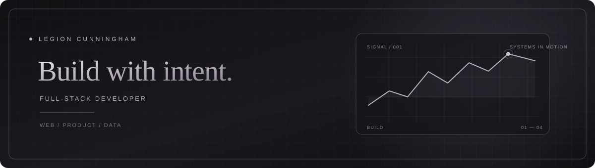

### `LEGION CUNNINGHAM` · FULL-STACK DEVELOPER

**Building thoughtful web experiences, useful tools, and systems that solve real problems.**

[Portfolio](https://portfoliov3-ashen-rho.vercel.app) · [Projects](https://github.com/Legionaka?tab=repositories)

---

## ⛧ About

I’m a developer focused on full-stack web applications. I enjoy taking an idea from interface to implementation—connecting polished, accessible experiences with the data and services behind them.

Currently building projects across web apps, dashboards, and data-driven tools. Take a look at my [portfolio](https://portfoliov3-ashen-rho.vercel.app) for more about my work.

## ☩ Featured work

| Project | What it is | Built with |
| --- | --- | --- |
| [**Stillwater**](https://github.com/Legionaka/paap_app5) | A mobile-first guide to fishing waters in South Africa, with location discovery and community features. | JavaScript · PostgreSQL |
| [**Medi-Clinic**](https://github.com/Legionaka/5SOC_Dash) | A role-based clinic portal with patient and care-team workflows. | Next.js · React · Supabase · PostgreSQL |
| [**Bank Statement Manager**](https://github.com/Legionaka/bank-manager) | Import bank statements, organize transactions, and track shared expenses. | Next.js · Supabase |

More projects and details are on my [portfolio](https://portfoliov3-ashen-rho.vercel.app).

## ⚙ Tools of the trade

## ☽ GitHub activity

---

**Have an interesting project in mind?**  
[Visit my portfolio](https://portfoliov3-ashen-rho.vercel.app) · [Browse my repositories](https://github.com/Legionaka?tab=repositories)

Made with care, in the dark.

